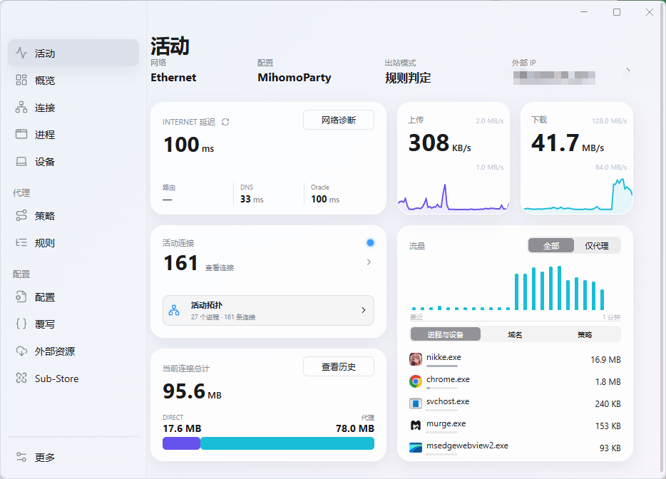
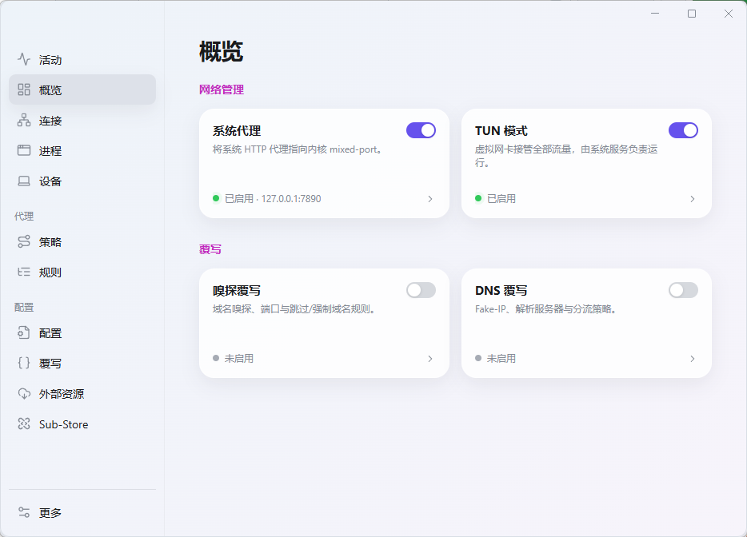
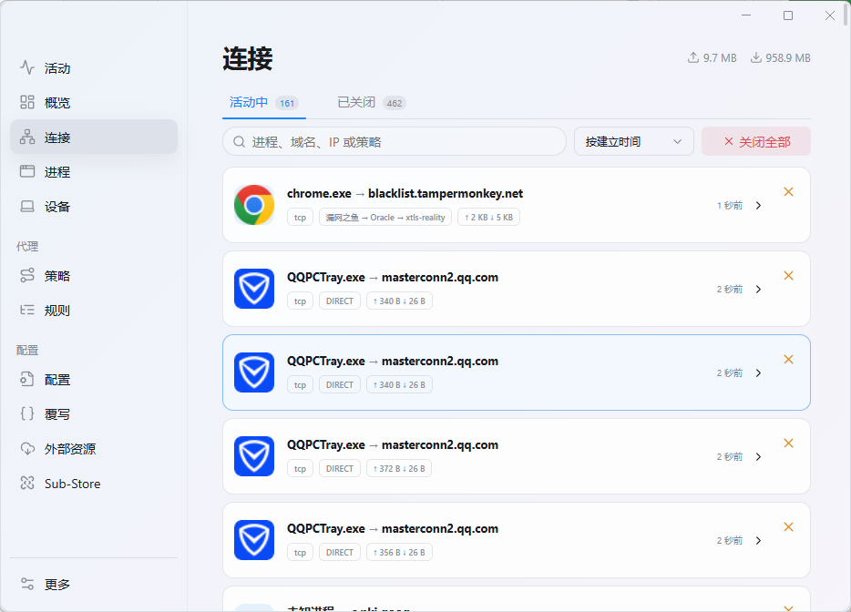
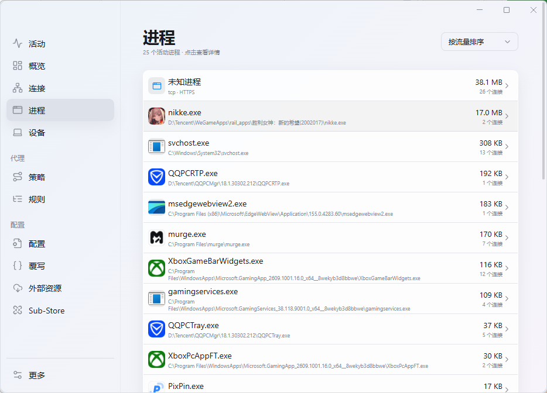
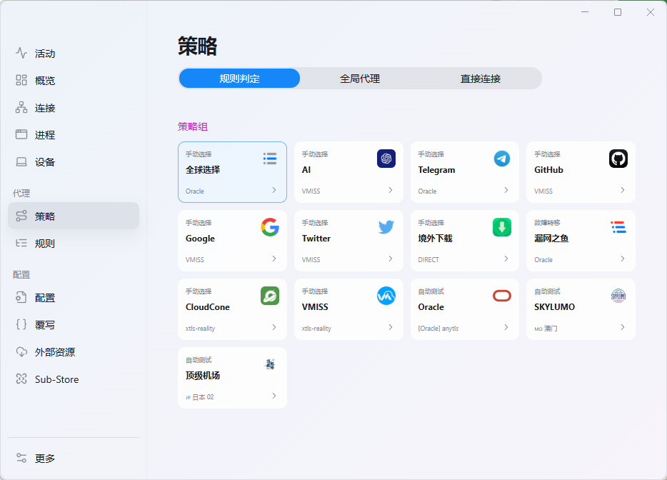
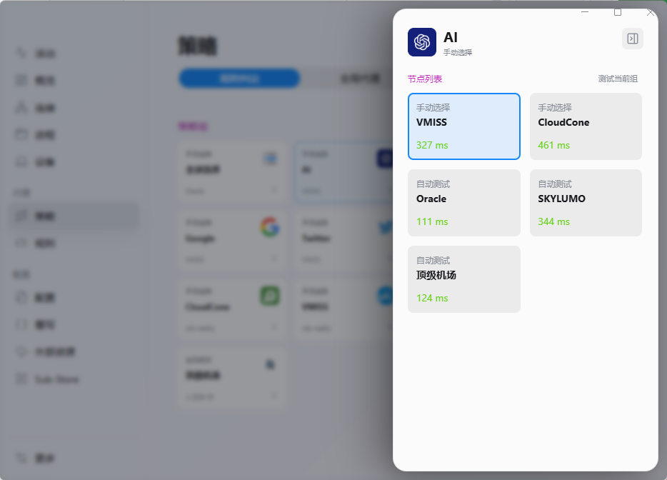

# Murge

<div align="center">

**Another [Mihomo](https://github.com/MetaCubeX/mihomo) GUI**

[](https://github.com/RoaycL/Murge/releases/latest)
[](LICENSE)

</div>

Murge 是一款基于 Electron + Vue 3 构建的现代化 Mihomo 图形客户端，专注于提供简洁、高效的代理管理体验。

## 项目近况与反馈

目前 Murge 的功能已经满足我个人的日常使用需求，后续会围绕实际使用中的问题和大家的反馈持续改进。如果你发现 Bug，或希望添加新功能，欢迎提交 [Issues](https://github.com/RoaycL/Murge/issues)。Codex 和 Claude 老师会第一时间一起研究，排查问题、评估需求并推进开发。

反馈 Bug 时，请尽量附上应用版本、复现步骤、相关日志或截图；提出新功能时，也欢迎说明使用场景和期望效果，方便我们更快理解和处理。

## 界面预览

### 活动

查看网络延迟、实时上传下载速率、活动连接与应用流量。



### 概览

集中管理系统代理、TUN 模式、嗅探覆写和 DNS 覆写。



### 连接

查看活动与已关闭连接，按进程、域名、IP 或策略搜索，检查连接路径。



### 进程

按应用查看流量、连接数和程序路径。



### 策略

切换出站模式，查看策略组及当前选中的节点。



### 节点选择

展开策略组，查看节点延迟并切换节点。



## 特性

- **开箱即用** — 无需复杂配置，启动即用
- **TUN 模式** — 系统级虚拟网卡，全局代理无需手动配置系统代理
- **订阅管理** — 支持多订阅配置，自动更新与切换
- **策略组** — 可视化节点管理，支持手动选择、自动测速、故障转移
- **规则引擎** — 完整支持 Mihomo 规则集，实时查看规则命中统计
- **系统代理** — 一键接管/恢复系统代理，智能记忆原状态
- **深色主题** — 支持明暗双主题，自适应系统外观
- **自动更新** — 应用内自动检查更新，支持 GitHub 镜像加速
- **本地诊断报告** — 从日志页导出启动耗时、任务/服务状态和端口归属；不包含原始日志与订阅密钥
- **配置备份与 WebDAV 同步** — 密码加密导出网络配置、订阅和 Sub-Store 用户数据，可上传至 HTTPS WebDAV；恢复前预览并检查版本兼容性
- **进程分流** — 从活动进程直接生成置顶覆写规则，保存前预览并可撤销
- **连接分流与诊断** — 从连接目标生成域名覆写规则；查看命中规则、策略链以及当前 DNS、网关、DIRECT、代理和 TUN 状态
- **应用流量历史** — 按小时记录内核可识别进程的流量，展示最近时段的应用排行

## 下载

前往 [Releases](https://github.com/RoaycL/Murge/releases) 页面下载最新版本。

目前支持 Windows x64 与 arm64。

> **macOS 用户**：Murge 不提供 macOS 版本。如需 macOS 客户端，请使用 [Surge](https://nssurge.com) —— Murge 的 UI 设计即参考自此项目。

## 技术栈

- **前端**：Vue 3 + TypeScript + Vite
- **后端**：Electron + Node.js
- **内核**：[Mihomo](https://github.com/MetaCubeX/mihomo)（Clash Meta）

## 开发

```bash
# 安装依赖
npm install

# 启动开发服务器
npm run dev

# 构建
npm run build

# 打包 Windows 安装包
npm run package:win
```

## 许可证

Murge 依据 [GNU General Public License v3.0](LICENSE) 开源发布。

第三方组件许可证详见 [THIRD_PARTY_NOTICES.md](resources/THIRD_PARTY_NOTICES.md)。

## 致谢

- [MetaCubeX/mihomo](https://github.com/MetaCubeX/mihomo) — 规则代理内核（本项目基于此构建）
- [Surge](https://nssurge.com) — UI 设计参考
- [mihomo-party-org/clash-party](https://github.com/mihomo-party-org/clash-party) — 参考实现
- [clash-verge-rev/clash-verge-rev](https://github.com/clash-verge-rev/clash-verge-rev) — 参考实现
- [xishang0128/sparkle](https://github.com/xishang0128/sparkle) — 参考实现
