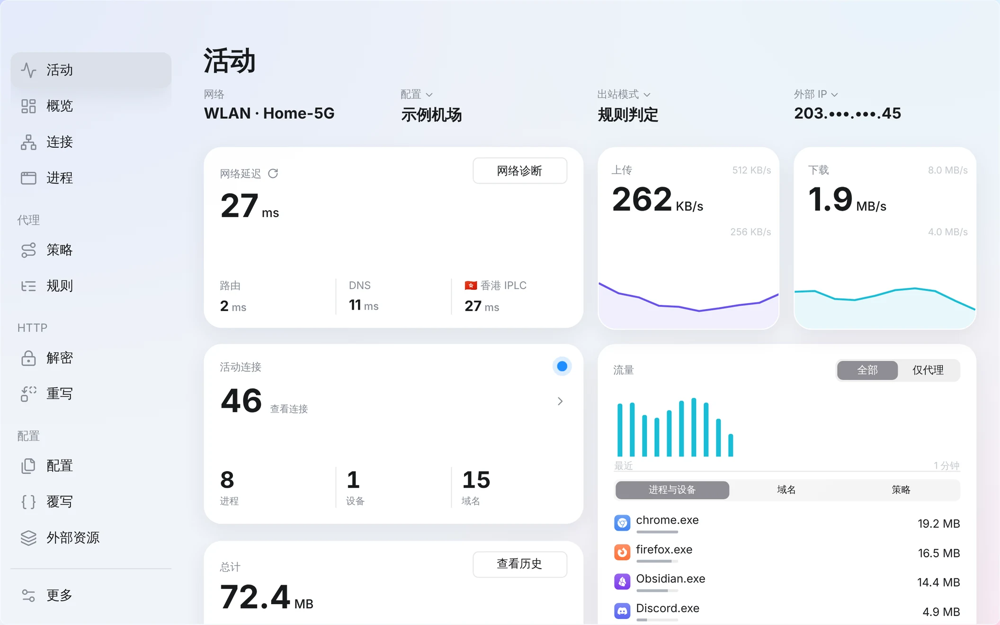
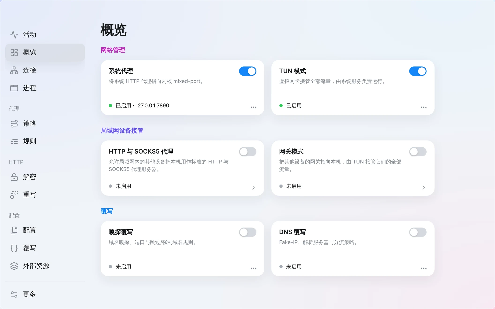
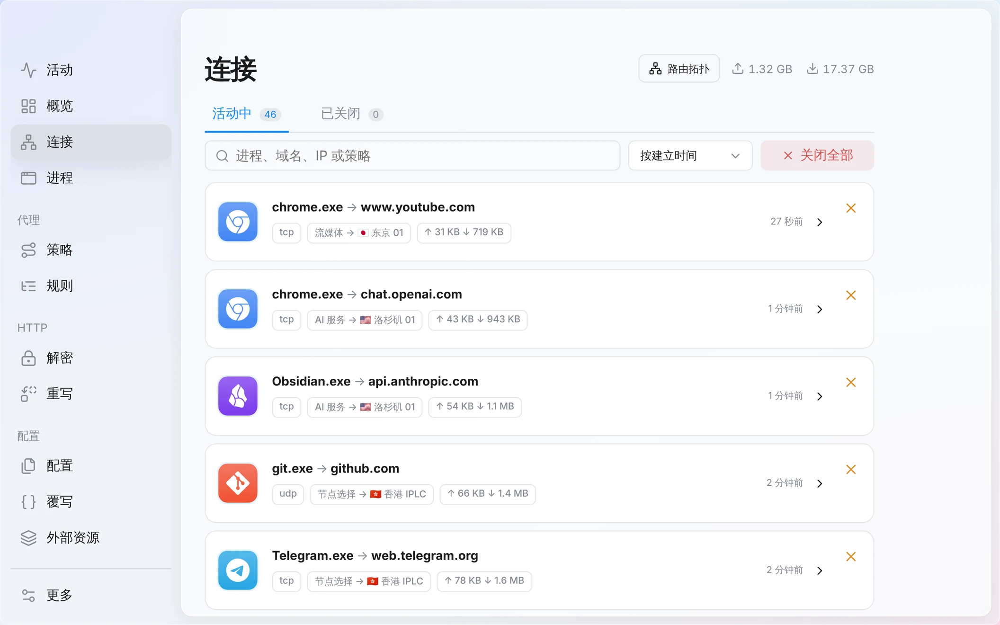
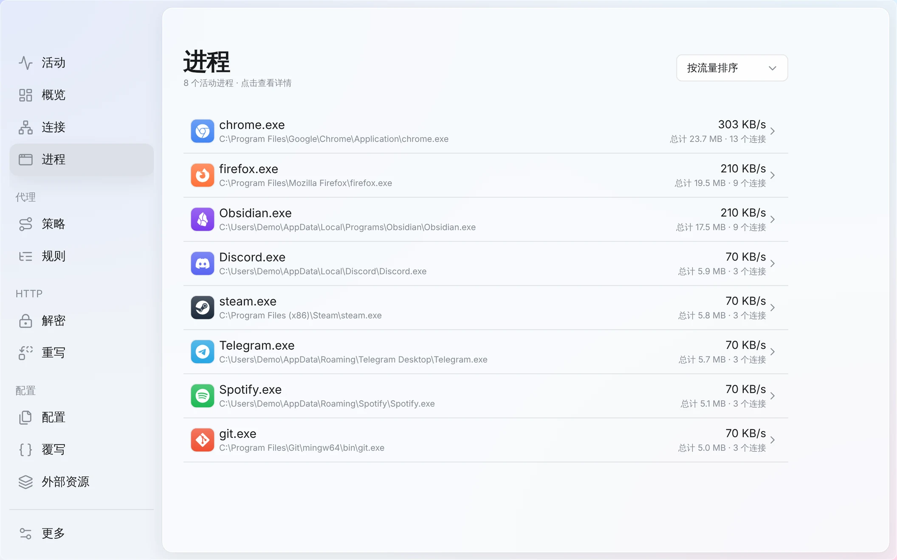
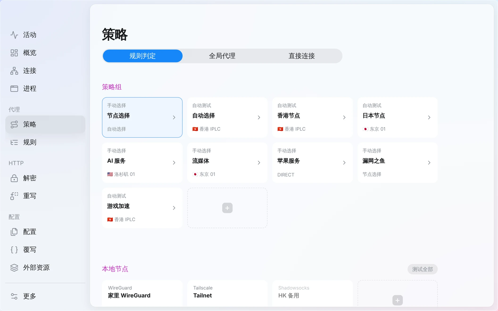
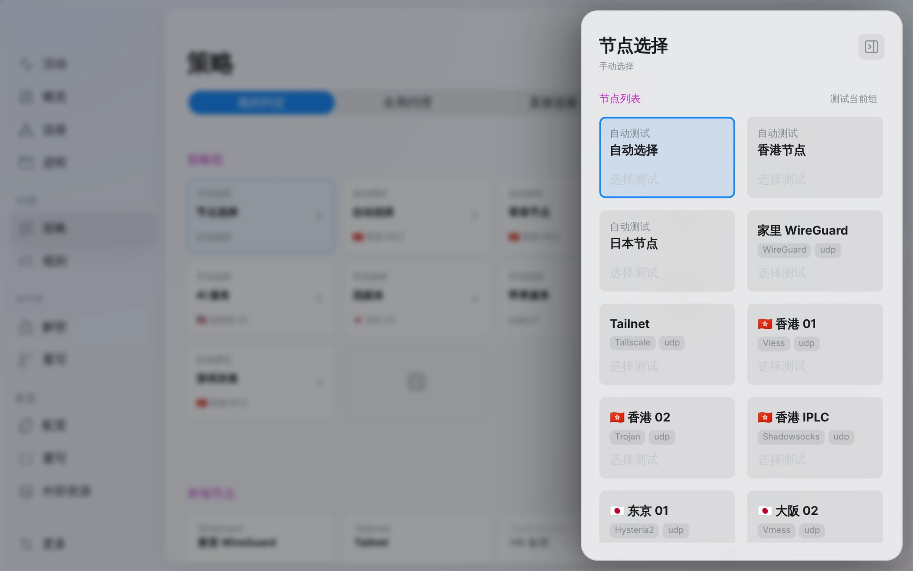

# Murge

<div align="center">

**Another [Mihomo](https://github.com/MetaCubeX/mihomo) GUI**

[](https://github.com/RoaycL/Murge/releases/latest)
[](LICENSE)

</div>

Murge 是一款基于 Tauri + Vue 3 构建的现代化 Mihomo 图形客户端，专注于提供简洁、高效的代理管理体验。

## 项目近况与反馈

目前 Murge 的功能已经满足我个人的日常使用需求，后续会围绕实际使用中的问题和大家的反馈持续改进。如果你发现 Bug，或希望添加新功能，欢迎提交 [Issues](https://github.com/RoaycL/Murge/issues)。Codex 和 Claude 老师会第一时间一起研究，排查问题、评估需求并推进开发。

反馈 Bug 时，请尽量附上应用版本、复现步骤、相关日志或截图；提出新功能时，也欢迎说明使用场景和期望效果，方便我们更快理解和处理。

欢迎加入 [Telegram 交流群](https://t.me/murgeapp)，分享使用体验、交流配置和讨论新功能。Bug 与功能请求建议同时提交 Issues，方便跟踪处理进度。

## 宣传视频

点击下图观看约 40 秒的功能演示。

<a href="docs/media/murge-promo.mp4">
<picture>
  <source media="(prefers-color-scheme: dark)" srcset="docs/media/promo-poster-dark.webp">
  
</picture>
</a>

## 界面预览

### 活动

查看网络延迟、实时上传下载速率、活动连接与应用流量。

<picture>
  <source media="(prefers-color-scheme: dark)" srcset="docs/screenshots/activity-dark.webp">
  
</picture>

### 概览

集中管理系统代理、TUN 模式、嗅探覆写和 DNS 覆写。

<picture>
  <source media="(prefers-color-scheme: dark)" srcset="docs/screenshots/overview-dark.webp">
  
</picture>

### 连接

查看活动与已关闭连接，按进程、域名、IP 或策略搜索，检查连接路径。

<picture>
  <source media="(prefers-color-scheme: dark)" srcset="docs/screenshots/connections-dark.webp">
  
</picture>

### 进程

按应用查看流量、连接数和程序路径。

<picture>
  <source media="(prefers-color-scheme: dark)" srcset="docs/screenshots/processes-dark.webp">
  
</picture>

### 策略

切换出站模式，查看策略组及当前选中的节点。

<picture>
  <source media="(prefers-color-scheme: dark)" srcset="docs/screenshots/policies-dark.webp">
  
</picture>

### 节点选择

展开策略组，查看节点延迟并切换节点。

<picture>
  <source media="(prefers-color-scheme: dark)" srcset="docs/screenshots/policy-nodes-dark.webp">
  
</picture>

## 特性

### 代理与网络

- **系统代理** — 一键接管 / 还原 Windows 系统代理，记住接管前的设置，可选代理守护防止被其他软件改掉
- **TUN 模式** — 由独立的 Windows 核心服务创建虚拟网卡，不认系统代理的程序也能走代理；可选自动屏蔽 QUIC
- **网关模式** — 开启后自动打开 IPv4 转发，把局域网设备的网关指向本机即可接管；「设备」页查看这些设备和它们的流量
- **局域网代理** — 向局域网提供 HTTP / SOCKS5 代理端口
- **DNS 与嗅探覆写** — 在不改订阅的前提下覆盖 DNS 和域名嗅探设置

### HTTP 解密与重写

- **HTTPS 解密（MitM）** — 生成并安装本机根证书，按主机名逐个开关
- **重写与映射** — 支持 Surge 模块语法，兼容 Loon、Quantumult X、Stash、Egern 的常见写法；URL 重写、请求头 / 响应体改写（含 jq）、本地映射
- **脚本** — 内置 JavaScript 引擎运行请求 / 响应脚本，模块参数可在界面中修改

### 配置与订阅

- **订阅管理** — 多订阅配置，自动更新与切换
- **覆写** — 在订阅之上叠加规则和设置，保存前预览，可撤销；可从活动进程或连接目标直接生成分流规则
- **外部资源** — 统一查看并更新代理集合、规则集合、模块、脚本与地理数据库
- **Sub-Store** — 内置 Sub-Store，管理与转换订阅
- **配置备份** — 密码加密导出配置、订阅和 Sub-Store 数据，可上传到 HTTPS WebDAV；恢复前预览并检查版本兼容性

### 观察与诊断

- **活动与连接** — 延迟、实时速率、活动 / 已关闭连接、命中规则与策略链，已解密的连接会单独标出
- **进程与流量历史** — 按应用查看连接数和流量，按小时记录应用流量排行
- **策略组** — 可视化节点管理，延迟测试，手动选择、自动测速、故障转移
- **日志与诊断报告** — 筛选并导出脱敏日志；诊断报告包含启动耗时、服务状态和端口归属，不含配置与订阅密钥

### 应用

- **签名自动更新** — 更新包必须带有发布密钥的签名，GitHub 镜像只负责传输；可选「包括 Beta 版本」提前体验新功能
- **开机自启与静默启动**，关闭窗口后可留在托盘
- **外观** — 浅色 / 深色 / 跟随系统，毛玻璃窗口

## 下载

前往 [Releases](https://github.com/RoaycL/Murge/releases) 页面下载最新版本（正式版标为 Latest，Beta 为预发布版本）。

目前支持 Windows 10 / 11 的 x64 与 arm64。安装包会在需要时自动安装 Microsoft Edge WebView2 运行时。

> **macOS 用户**：Murge 不提供 macOS 版本。如需 macOS 客户端，请使用 [Surge](https://nssurge.com) 

网络异常时的恢复方法见 [网络恢复](docs/NETWORK_RECOVERY.md)。

## 技术栈

- **界面**：Vue 3 + TypeScript + Vite
- **桌面端**：Tauri 2（Rust），HTTPS 解密与重写引擎同样由 Rust 实现
- **核心服务**：Go 编写的 Windows 服务，负责以系统权限运行内核和 TUN
- **内核**：[Mihomo](https://github.com/MetaCubeX/mihomo)（Clash Meta）

## 开发

需要 Node.js（20.19+ 或 22.12+）、Rust 稳定版和 Go 1.25。

```bash
# 安装依赖
npm install

# 启动开发版
npm run tauri:dev

# 运行测试
npm test                      # 界面与脚本
(cd src-tauri && cargo test)  # Rust
npm run tun-service:test      # 核心服务

# 打包 Windows 安装包（x64 + arm64）
npm run package:tauri
```

发布流程见 [docs/RELEASES.md](docs/RELEASES.md)，HTTPS 解密与重写的设计见 [docs/MITM_REWRITE.md](docs/MITM_REWRITE.md)。

## 许可证

Murge 依据 [GNU General Public License v3.0](LICENSE) 开源发布。

第三方组件许可证详见 [THIRD_PARTY_NOTICES.md](resources/THIRD_PARTY_NOTICES.md)。

## 致谢

- [MetaCubeX/mihomo](https://github.com/MetaCubeX/mihomo) 
- [Surge](https://nssurge.com) 
- [mihomo-party-org/clash-party](https://github.com/mihomo-party-org/clash-party) 
- [clash-verge-rev/clash-verge-rev](https://github.com/clash-verge-rev/clash-verge-rev) 
- [xishang0128/sparkle](https://github.com/xishang0128/sparkle) 
